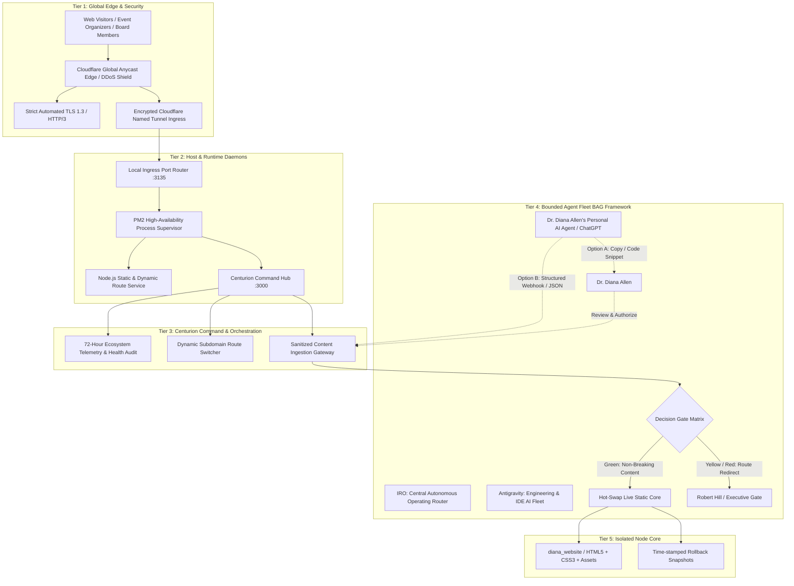

# 🏛️ The Centurion Ecosystem — High-Level Infrastructure & AI Integration Blueprint
### Architectural Overview for Dr. Diana B. Allen & Her AI Systems
**Document Version:** 1.0.0 (Sanitized Executive Specification)  
**Security Classification:** Public / Partner Handoff (Zero Secrets / Zero Private Keys)  
**Governing Authority:** Director Robert Hill & The Centurion Engineering Fleet  
**Associated Target Node:** Dr. Diana B. Allen Executive Authority Hub (`diana.bullmight.com`)

---

## 1. Executive Overview

The **Centurion Ecosystem** is an enterprise multi-brand digital operating infrastructure. It provides zero-latency content delivery, dynamic intelligent routing, continuous health monitoring, and a bounded autonomous AI agent fleet governed by strict human-in-the-loop safety gates.

This document details the multi-tiered architecture of the Centurion Ecosystem and explains how **Dr. Diana B. Allen's Executive Node** interfaces with it, enabling her personal AI agent (ChatGPT, Claude, or custom API agents) to safely inspect the environment, suggest adjustments, and push updates without compromising system integrity.

---

## 2. Multi-Tier Architecture Diagram



---

## 3. The 5 Infrastructure Tiers Explained

### Tier 1: Global Edge & Ingress Layer
- **Cloudflare Anycast Network:** All traffic entering `diana.bullmight.com`, `dr.bullmight.com`, and `drallen.bullmight.com` passes through globally distributed edge points of presence (PoPs).
- **Zero Open Inbound Ports:** No public ports (80/443) are exposed directly on the origin host. Instead, an outbound-only encrypted Cloudflare Named Tunnel securely bridges web traffic to the origin application layer.
- **DDoS Mitigation & Edge Caching:** Static assets (headshots, CSS, favicons) are cached at the edge for sub-100ms global delivery.

### Tier 2: Process & Runtime Layer
- **Daemon Supervision:** Managed by PM2 enterprise process manager with zero-downtime restarts, memory capping, and auto-recovery on system reboot.
- **Port Isolation:** Dr. Diana's node runs in its own isolated execution sandbox (`:3135`), separated from other ecosystem applications (benefits, payroll, state compliance).
- **Lightweight Overhead:** Zero heavy runtime frameworks or heavyweight databases. Serves pure, unbloated static files with near-instant TTFB (Time to First Byte).

### Tier 3: Centurion Command & Orchestration Hub
- **Executive Cockpit (`cent.bullmight.com`):** Centurion aggregates all active nodes, marketing engines, and compliance dashboards into a unified operational command center.
- **Dynamic Routing Switcher:** Controls whether subdomains point to the static authority website, a live webinar broadcast, an executive briefing room, or an external portal (e.g. GoHighLevel or Zoom) via runtime configuration.
- **72-Hour Autonomous Telemetry:** Centurion continuously audits process health, latency, memory consumption, and link integrity.

### Tier 4: Autonomous AI Agent Fleet & Bounded Governance (BAG)
The Centurion system operates under the **Bounded Agentic Growth (BAG)** framework. AI systems have bounded authority divided into a strict Gate Matrix:
1. **🟢 Green Gate (Fully Autonomous):** Read-only audits, CSS token adjustments, copy tweaks in pre-designated content slots, asset format verification.
2. **🟡 Yellow Gate (Staged / 12-Hour Review Queue):** Structural HTML additions (new page sections, new keynote tracks), dynamic destination URL modifications.
3. **🔴 Red Gate (Hard-Gated Human Approval):** Domain reassignment, primary DNS modification, SSL reconfiguration, production deployment cutovers.

### Tier 5: Dr. Diana Allen's Node Architecture
- **Root Directory:** Dedicated isolated workspace (`diana_website/`).
- **Core Artifacts:**
  - `index.html` (Master Authority Landing Page)
  - `speaker-kit.html` (Media Kit & Keynote Catalog)
  - `privacy.html` / `terms.html` (Compliance & Defensibility)
  - `/assets/` (Optimized transparent feathered headshots and graphics)
  - `/configs/` (Runtime route destinations)

---

## 4. How Dr. Diana Allen's AI Can Safely Update the Site

Yes, Dr. Diana Allen's personal AI agent (ChatGPT, Claude, or a custom assistant) can actively maintain and update her platform. Three supported integration pathways exist:

### Pathway 1: AI Prompt-to-Snippet (Assisted — Available Immediately)
1. Dr. Diana asks her ChatGPT agent: *"Add a keynote on 'AI Risk Governance in Healthcare' to my site."*
2. ChatGPT refers to the **Master Guide** (`Dr_Diana_Allen_Website_AI_Master_Guide.md`), outputs the exact `<div class="card keynote-card">` HTML snippet.
3. Dr. Diana (or Robert) pastes the snippet into the site file or sends it via chat. The change renders live instantly.

### Pathway 2: Structured Content Webhook API (Programmatic AI Updates)
Dr. Diana's AI can interface with an authenticated HTTP endpoint to update specific content blocks without touching raw source files:

- **Endpoint:** `POST https://diana.bullmight.com/api/update-content` *(Configurable)*
- **Header:** `Authorization: Bearer <SECURE_TENANT_KEY>`
- **Payload Schema:**
```json
{
  "section": "keynotes",
  "action": "append",
  "data": {
    "title": "AI Risk Governance & Autonomous Accountability",
    "audience": "Board of Directors & Executive Committees",
    "description": "How modern enterprises establish audit trails, legal defensibility, and oversight for autonomous AI agent networks.",
    "takeaways": [
      "Board liability under emerging AI safety standards",
      "Building verifiable algorithmic audit gates",
      "Executive decision frameworks for enterprise LLM deployment"
    ]
  }
}
```
- **Automated Safety Pipeline:**
  1. The server receives the JSON payload.
  2. A pre-publish compliance linter validates structure and escapes any hazardous tags.
  3. A versioned backup (`index.html.bak-<timestamp>`) is created automatically.
  4. The static template injects the validated content slot.
  5. The site refreshes with zero downtime.

### Pathway 3: Git-Based AI DevOps (GitHub Push / PR)
If Dr. Diana's AI uses GitHub (e.g. Claude Code, Cursor, or GitHub Copilot Workspace):
1. Her AI creates a branch, commits the update, and opens a Pull Request.
2. A deployment webhook notifies the Centurion server upon merge.
3. The server pulls the verified commit and serves the updated build instantly.

### Pathway 4: 100% Self-Sovereign Export
Because the site is architected in clean, standard HTML5/CSS3 with zero proprietary dependencies, Dr. Diana's AI can at any time export the entire codebase and deploy it to:
- Her own **GoHighLevel (GHL)** sub-account (Custom Code / Funnel element).
- Her own **Cloudflare Pages** or **Vercel** account.
- Any traditional web hosting provider (WordPress, Apache, Nginx).

---

## 5. Safe Adjustment Guidelines for External AI Agents

When Dr. Diana's AI agent proposes adjustments to her site or ecosystem integrations, it should follow these four design doctrines:

1. **Preserve the CSS Token Structure:**  
   Always reference existing brand variables (`--bg`, `--card`, `--pink`, `--ink`, `--body`, `--muted`, `--line`). Never introduce hardcoded hex colors or inline styles unless creating a unique accent.
2. **Respect the Bounded Layout Grid:**  
   The site uses a responsive container (`max-width: 1200px`) with flexbox and CSS grid cards (`grid-template-columns: repeat(auto-fit, minmax(320px, 1fr))`). New components should follow this pattern so mobile layouts remain flawless.
3. **No Heavy Third-Party Dependencies:**  
   Do not introduce heavy client-side JavaScript frameworks (React bundles, jQuery, Bootstrap). All interactivity (dynamic routing, navigation, modals) is handled by lightweight, native browser APIs.
4. **Idempotent Updates:**  
   Every update generated by an AI should be atomic and fully formed, ensuring that applying the update twice does not duplicate content or corrupt layout tags.

---

## 6. Architecture Summary Table

| Layer | Technology | Function | Security Boundary |
| :--- | :--- | :--- | :--- |
| **Edge Network** | Cloudflare Edge / Anycast | Global DNS, CDN Caching, SSL/TLS | Zero public origin IPs exposed |
| **Ingress** | Cloudflare Named Tunnel | Outbound encrypted application tunnel | Origin firewall blocks all raw inbound traffic |
| **Process Manager**| PM2 Enterprise Daemon | Port 3135 supervisor, auto-restart, logging | Sandboxed unprivileged local process |
| **Application** | Node.js Vanilla Micro-router | Static server + dynamic destination router | Strict path traversal checks (`path.resolve`) |
| **Design System** | Pure CSS3 Variables & Tokens | Dark executive editorial palette | Zero external CSS frameworks needed |
| **AI Governance** | BAG Framework / Gate Matrix | Multi-agent coordination & human vetoes | Yellow/Red gates block unauthorized mutations |

---
*Centurion Ecosystem Architecture Specification • Prepared for Dr. Diana B. Allen & Executive Partners*
